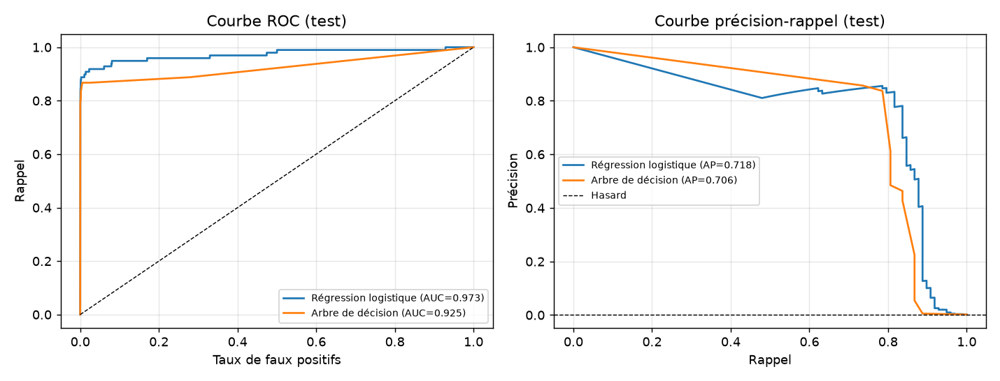
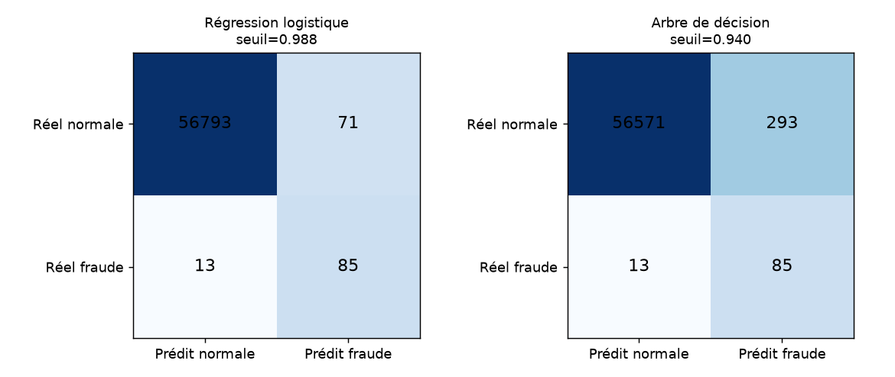

# 1. Contexte et périmètre

**Mission.** Qualifier, en tant qu'ingénieur QA IA, un pipeline de détection de fraude par carte bancaire : données, prétraitement, modèle, prédiction, intégration, robustesse, performance, CI.

**Périmètre.** `app/` (accès aux données, validation, prétraitement, entraînement, seuil, prédiction, métriques), `tests/` (112 tests), `.github/workflows/tests.yml`, `scripts/run_qualification.py`.

**Données et environnement d'exécution.** Jeu Kaggle *Credit Card Fraud Detection* (`mlg-ulb/creditcardfraud`) : **284 807 transactions dont 492 fraudes (0,173 %)**. Découpage stratifié 60/20/20, graine 42 :

| Partition | Transactions | Fraudes |
|---|---|---|
| Entraînement | 170 883 | 295 |
| Validation | 56 962 | 99 |
| Test | 56 962 | 98 |

Évaluation exécutée sous Windows, Python 3.14.7, scikit-learn 1.9.1, NumPy 2.5.5, pandas 3.1.1. Les tests unitaires, d'intégration et de robustesse utilisent volontairement un **jeu synthétique rapide** (fixtures déterministes) ; seul le test de non-régression rejoue l'entraînement sur le jeu réel.

**Reproduire.**

```
pip install -r requirements.txt
python scripts/run_qualification.py --download --require-real --update-baseline
python -m pytest
```

Le téléchargement utilise `kagglehub.dataset_download("mlg-ulb/creditcardfraud")` ; `data/creditcard.csv` est aussi accepté s'il existe déjà.

# 2. Plan de test et matrice de traçabilité

**Outils et preuves conservées :** pytest, pytest-cov, Hypothesis, Ruff, psutil, joblib ; preuves dans `reports/` (`pytest_rapport.txt`, `coverage.xml`, `ruff_rapport.txt`, `resultats.json`, graphiques, `echec_volontaire.txt`) et dans l'historique GitHub Actions.

**Critères d'acceptation (fixés avant d'observer le jeu de test, réglés sur train/validation) :**

- Exigence métier : **rappel ≥ 80 %** et **taux de faux positifs ≤ 1 %** sur la validation (une fraude manquée coûte plus qu'une alerte inutile, mais plus de 1 % de clients légitimes bloqués est inacceptable).
- Aucun test bloquant en échec ; couverture ≥ 85 % ; Ruff sans erreur.
- Aucune anomalie de gravité **critique** ouverte.
- **Rejet** si : fuite de données avérée, non-régression hors tolérance, probabilité hors [0,1], exigences métier non atteintes sur validation.

| ID | Exigence | Type | Résultat attendu | Risque maîtrisé | Test(s) | Statut |
|---|---|---|---|---|---|---|
| T01 | Colonnes nécessaires présentes, sans doublon | Données | Rejet explicite sinon | Prédictions silencieusement fausses | `test_missing_required_column_is_rejected`, `test_duplicated_column_is_rejected` | ✅ |
| T02 | Types conformes au contrat, cible ∈ {0,1} | Unitaire | Rejet des types/cibles invalides | Corruption de l'apprentissage | `test_wrong_type_is_rejected`, `test_target_other_than_0_1_is_rejected` | ✅ |
| T03 | Prétraitement sans NaN/inf en sortie | Unitaire | Aucune valeur non finie | Plantage ou prédiction aberrante | `test_preprocess_output_is_finite_and_ordered`, `test_no_non_finite_values_after_preprocessing_and_scaling` | ✅ |
| T04 | Probabilité valide | Fonctionnel ML | 0 ≤ p ≤ 1, finie | Décision incohérente | `test_probabilities_are_valid`, test Hypothesis (50 cas) | ✅ |
| T05 | Évaluation sur données indépendantes | ML | Test non utilisé pour le réglage | Performance surestimée | `test_scaler_is_fitted_on_train_only`, `test_imputer_statistics_come_from_train_only`, `test_train_val_test_have_no_common_rows` | ✅ |
| T06 | Résultats reproductibles | Non-régression | Écart ≤ tolérance | Résultats invérifiables | `test_full_run_is_reproducible`, `test_results_match_baseline_exactly_with_same_seed_and_env` | ✅ |
| T07 | Tests exécutés sur GitHub | CI | Workflow réussi ou échec signalé | Régression non détectée | `tests.yml` + `echec_volontaire.txt` | ⚠️ Partiel : workflow fourni, exécution GitHub à réaliser (§9) |
| **T08** | Valeurs infinies toujours rejetées | Robustesse | `DataValidationError` | Probabilités saturées/NaN en production | `test_infinite_values_are_rejected` | ✅ |
| **T09** | Aucune fuite via l'ajustement du scaler/imputer | Intégration | Statistiques = celles du train | Fuite de données, surestimation | tests de fuite + contrôle négatif `test_model_trained_on_test_would_be_detected_as_leak` | ✅ |
| **T10** | Découpage stratifié, disjoint, reproductible | Unitaire | Proportions de classes conservées | Test sans fraude, biais d'évaluation | `test_split_is_disjoint_complete_and_stratified` | ✅ |
| **T11** | Sauvegarde/rechargement cohérents | Intégration | Écart de probabilité ≤ 1e-12 | Modèle déployé ≠ modèle évalué | `test_predictions_identical_before_and_after_reload` | ✅ (écart mesuré sur le jeu réel : 0) |
| **T12** | NaN traités par imputation documentée | Robustesse | Probabilités valides | Rejet en masse de transactions | `test_nan_in_features_is_treated_by_imputation` | ✅ (mais voir A-04) |
| **T13** | Montant extrême sans saturation du modèle | Robustesse | Volume d'alertes stable | Avalanche de faux positifs ou fraudes masquées | `test_extreme_amount_should_not_change_alert_volume_massively` | ❌ **xfail strict (A-03)** |
| **T14** | Pas de secrets ni de données dans dépôt/journaux/erreurs | Sécurité | Aucun motif détecté | Fuite de données sensibles | `test_no_secrets_in_repository`, `test_no_sensitive_values_in_logs`, `test_error_messages_do_not_leak_row_values` | ✅ |
| **T15** | Budget de performance | Performance | P95 < 10 ms, > 10 000 pred/s, modèle < 1 Mo | Latence incompatible avec l'autorisation de paiement | `tests/test_performance.py` (marqué `slow`) et mesures du script | ✅ (marge faible, voir A-08) |
| **T16** | Non-régression contre une baseline figée | Non-régression | Dégradation < tolérance | Régression masquée | `test_no_regression_against_baseline`, `test_degraded_model_is_caught_by_the_control` | ✅ (rejoué sur le jeu réel) |
| **T17** | Colonnes supplémentaires ignorées (politique documentée) | Sécurité | Prédiction inchangée | Cible ou identifiant injectés vers le modèle | `test_extra_columns_are_ignored` | ✅ |
| **T18** | Accès Kaggle explicite et sûr (kagglehub, pas d'identifiants dans le code) | Intégration | Erreurs réseau/fichier absent signalées ; aucun téléchargement implicite | Résultats produits sur un mauvais jeu, secrets exposés | `tests/test_data_source.py` (10 tests hors réseau) | ✅ |

# 3. Architecture et choix méthodologiques

`CSV → load_data → validate_data → split_data (60/20/20, stratifié, graine 42) → Pipeline[SimpleImputer(médiane) → StandardScaler → classifieur] (ajusté sur train) → select_threshold (validation) → save/load (joblib) → predict_fraud → evaluate_model`.

Choix : séparation **avant** toute transformation apprise ; transformations dans un `Pipeline` scikit-learn (impossible d'ajuster le scaler sur le test par inadvertance) ; `class_weight="balanced"` ; choix du modèle sur la **PR-AUC de validation** ; seuil sélectionné sur la validation sous contraintes (rappel ≥ 80 %, FPR ≤ 1 %) avec repli documenté sur le F1 maximal ; politique de données **rejeter par défaut**, seule exception documentée : imputation médiane des NaN en prédiction.

# 4. Résultats des tests unitaires et d'intégration

| Suite | Résultat |
|---|---|
| Tests rapides (PR), exécution locale Windows avec le jeu réel présent | **108 réussis, 1 échec attendu (xfail strict A-03), 0 échec** (21,5 s) |
| Tests lents (performance) | 3 tests ; mesures équivalentes dans `resultats.json` (§7) |
| Couverture de `app/` | **98 %** (mesure en environnement de développement) |
| Ruff | Aucune erreur |
| Cohérence avant/après rechargement (jeu réel) | Écart max de probabilité **0,0** |

# 5. Performances du modèle

**Pourquoi l'accuracy trompe.** Sur le test, un modèle qui ne prédit jamais de fraude obtient **99,83 %** d'accuracy avec un rappel de 0 %. La régression logistique retenue obtient 99,85 % : l'accuracy distingue à peine un modèle inutile d'un modèle utile.

**Comparaison sur le jeu de test (seuil choisi sur la validation) :**

| Modèle | Seuil | Précision | Rappel | F1 | ROC-AUC | PR-AUC | FPR | FNR |
|---|---|---|---|---|---|---|---|---|
| Régression logistique | 0,988 | 0,545 | 0,867 | 0,669 | 0,973 | 0,718 | 0,125 % | 13,3 % |
| Arbre de décision | 0,940 | 0,225 | 0,867 | 0,357 | 0,925 | 0,706 | 0,515 % | 13,3 % |

**Matrices de confusion (test : 56 864 transactions normales, 98 fraudes) :**

| | TN | FP | FN | TP |
|---|---|---|---|---|
| Régression logistique | 56 793 | 71 | 13 | 85 |
| Arbre de décision | 56 571 | 293 | 13 | 85 |





**Sélection sur la validation (jamais sur le test).** Les deux modèles satisfont l'exigence métier sur la validation (rappel 80,8 % chacun ; FPR 0,12 % pour la régression logistique, 0,44 % pour l'arbre). La régression logistique est retenue : PR-AUC de validation légèrement supérieure (0,681 contre 0,668) et surtout **4 fois moins de faux positifs** pour le même rappel.

**Interprétation.**

- **Faux positifs et faux négatifs.** Avec le modèle retenu, 71 clients légitimes sur 56 864 sont signalés à tort (0,125 %) et 13 fraudes sur 98 passent inaperçues. Précision 54,5 % : **environ une alerte sur deux est une fausse alerte**, ce qui impose une revue humaine ou une authentification renforcée plutôt qu'un blocage automatique.
- **Compromis du seuil.** Au seuil par défaut 0,5, le rappel monte à 91,8 % (8 fraudes manquées) mais on obtient **1 370 faux positifs** (précision 6,2 %). Le seuil retenu (0,988) échange 5 fraudes détectées en moins contre 1 299 fausses alertes en moins.
- **Généralisation.** Régression logistique : PR-AUC 0,773 (train), 0,681 (validation), 0,718 (test) et ROC-AUC 0,993 / 0,975 / 0,973 : écart modéré, sans surapprentissage marqué. L'arbre montre un écart plus net sur la ROC-AUC (0,997 / 0,905 / 0,925).
- **Incertitude.** Avec 98 fraudes en test, le rappel de 86,7 % a un intervalle de confiance de Wilson à 95 % de **[78,6 % ; 92,1 %]** ; le FPR de [0,099 % ; 0,157 %]. La borne basse du rappel (78,6 %) est légèrement sous l'exigence de 80 % : l'exigence est atteinte en estimation ponctuelle, mais pas démontrée à 95 % de confiance.

# 6. Robustesse et non-régression

**Perturbations (modèle retenu, jeu de test, amplitudes documentées).** Le bruit est appliqué à V1–V28 seulement (composantes de même nature issues de l'ACP) ; `Amount` est perturbé séparément (échelle différente) ; `Time` n'est pas perturbé.

| Scénario | Politique | Δ proba moy. | Changement de classe | Rappel | Précision | FPR |
|---|---|---|---|---|---|---|
| Référence | — | — | — | 0,867 | 0,545 | 0,125 % |
| Bruit gaussien σ=0,05 sur V1–V28 | Traiter | 0,0077 | 0,012 % | 0,867 | 0,528 | 0,134 % |
| Bruit gaussien σ=0,1 | Traiter | 0,0156 | 0,018 % | 0,857 | 0,519 | 0,137 % |
| Bruit gaussien σ=0,3 | Traiter | 0,0519 | 0,107 % | 0,878 | 0,420 | 0,209 % |
| Amount +5 % | Traiter | 0,0033 | 0,047 % | 0,867 | 0,464 | 0,172 % |
| 5 % de NaN dans V1–V28 (imputation médiane) | Traiter (imputation) | 0,0229 | 0,126 % | 0,867 | 0,390 | 0,234 % |
| Décalage +1 sur V1–V28 | Alerter (dérive) | 0,0636 | 0,086 % | 0,837 | 0,766 | 0,044 % |
| **Amount = 10⁷** | Alerter / plafonner | **0,934** | **99,7 %** | 1,000 | **0,002** | **100 %** |
| Valeur infinie / colonne manquante / type texte | Rejeter | — | — | — | — | — |

Les trois entrées invalides de la dernière ligne sont bien **rejetées** (`DataValidationError`). On mesure la sensibilité plutôt que d'imposer une invariance.

**Lecture.** Le **rappel est stable** (0,84 à 0,88) pour toutes les perturbations réalistes, et très peu de transactions changent de classe (≤ 0,13 %). En revanche la **précision se dégrade nettement** : le seuil étant très élevé (0,988), de petites variations de probabilité suffisent à franchir la frontière pour les transactions proches de celle-ci. Un simple +5 % sur `Amount` fait passer les faux positifs de 71 à environ 98 (précision 0,464) ; 5 % de NaN les portent à environ 133 (précision 0,390). Le cas extrême `Amount = 10⁷` sature le modèle : presque toutes les transactions sont signalées.

**Non-régression.** La baseline (`tests/baseline.json`) enregistre version du code, versions des bibliothèques, graine, seuil (0,988), caractéristiques du jeu réel et métriques de validation. Elle n'est **jamais recalculée automatiquement** : elle ne change que par `--update-baseline`, action volontaire. Tolérances : rappel ±0,05, précision ±0,05, PR-AUC ±0,03, FPR +0,002. Contrôle négatif : un modèle volontairement dégradé (arbre de profondeur 1, 20 % de labels corrompus) viole les tolérances (`test_degraded_model_is_caught_by_the_control`).

| Comparaison (validation, jeu réel) | Rappel | Précision | PR-AUC | FPR | Décision |
|---|---|---|---|---|---|
| Baseline (régression logistique) | 0,808 | 0,537 | 0,681 | 0,121 % | Référence |
| Nouvelle version (code inchangé, test rejoué) | dans la tolérance | dans la tolérance | dans la tolérance | dans la tolérance | **Accepter** |
| Version dégradée (simulation) | hors tolérance | — | — | — | **Rejeter** |

**Preuve d'échec volontaire.** Sur une copie de travail, deux défauts ont été injectés (valeurs infinies acceptées, scaler ajusté sans les données d'entraînement) : **14 tests échouent** (`echec_volontaire.txt`, dont 1 artefact lié à la copie sans `.gitignore`). La suite détecte donc bien ces régressions.

# 7. Performance et sécurité opérationnelle

**Protocole.** Machine unique (Windows, Python 3.14.7), un processus, `time.perf_counter`, 20 appels d'échauffement, 300 prédictions unitaires, puis 20 lots de 1 000. Mesure du **modèle seul** (validation d'entrée incluse) : une requête API ajouterait HTTP et sérialisation, non mesurés ici.

| Mesure | Résultat | Seuil d'acceptation (justification) | Verdict |
|---|---|---|---|
| Latence unitaire P95 | **9,26 ms** (moy. 8,86 ms, médiane 8,80 ms) | < 10 ms : l'autorisation d'un paiement se joue en dizaines de ms, le modèle ne doit en consommer qu'une fraction | ✅ marge faible (A-08) |
| Débit en lot (1 000 lignes) | ≈ 97 970 pred/s | > 10 000 pred/s | ✅ |
| Taille du modèle | 3,2 Ko | < 1 Mo | ✅ |
| Mémoire (RSS du processus) | ≈ 362 Mo | Dominée par l'import des bibliothèques ; à borner en conteneur | ℹ️ à fixer |

La latence mesurée ici est environ 3,5 fois supérieure à celle observée sur un environnement Linux de développement (≈ 2,6 ms) : les valeurs dépendent fortement de la machine et doivent être refaites sur la cible de déploiement.

**Sécurité opérationnelle (tests réussis).** Champs manquants et types incorrects rejetés ; colonnes supplémentaires ignorées (politique documentée) ; aucune valeur d'entrée dans les journaux ni dans les messages d'erreur ; aucun secret dans le dépôt ; `.gitignore` exclut les données et clés ; aucun identifiant Kaggle dans le code (variables d'environnement ou secrets GitHub). **Non couvert :** validation de fichiers reçus par une API (aucune API dans le prototype), tests de charge Locust/JMeter.

# 8. Biais et limites de l'évaluation (Activité 7)

Le jeu Credit Card Fraud ne contient **aucun attribut de groupe** (âge, sexe, localisation). Les composantes V1–V28 sont issues d'une ACP anonymisée : en déduire des groupes démographiques serait **inventer des attributs** et produirait des conclusions sans valeur. **Aucune conclusion d'équité n'est donc possible** avec ce jeu.

Données nécessaires pour un audit réel : attributs légalement utilisables par client (zone géographique, tranche d'âge, ancienneté, canal de paiement), avec labels fiables. Indicateurs à comparer : rappel, FPR et précision par groupe, avec **intervalles de confiance** (les groupes à peu de fraudes donnent des intervalles très larges, comme ici avec 98 fraudes au total). Outils : Fairlearn ou AI Fairness 360. Recommandation : audit de biais obligatoire avant tout déploiement réel ; il n'est pas réalisable en l'état.

# 9. Automatisation GitHub Actions

Le fichier `.github/workflows/tests.yml` est fourni : à chaque Pull Request et chaque push sur `main`, il installe l'environnement Python, exécute **Ruff**, puis **pytest avec couverture** (seuil d'échec à 85 %, `coverage.xml` publié en artefact) ; tout échec rend le job rouge. Les expériences coûteuses (tests lents, évaluation complète avec téléchargement Kaggle) ne tournent que manuellement (`workflow_dispatch`) ou chaque lundi (`schedule`). Sans `creditcard.csv` dans le dépôt, les tests de non-régression qui rejouent l'entraînement sur le jeu réel sont ignorés (*skipped*) dans les exécutions rapides : c'est voulu, le fichier n'étant pas versionné.

**Reste à faire (non réalisable depuis cet environnement)** : créer le dépôt GitHub, pousser le code, activer la protection de `main` (checks obligatoires) si les droits le permettent, puis capturer une exécution réussie et provoquer un échec volontaire (par exemple en cassant `validate_data` dans une branche de test). La preuve locale équivalente est dans `reports/echec_volontaire.txt`. **L'URL du dépôt et les captures d'exécution ne sont pas fournies** : elles dépendent de votre compte GitHub.

# 10. Anomalies

| ID | Description | Gravité | Statut |
|---|---|---|---|
| **A-03** | Un `Amount` hors plage sature le modèle : avec `Amount = 10⁷`, 99,7 % des transactions sont signalées (FPR 100 %, précision 0,2 %). Selon le signe du coefficient, le même défaut peut aussi masquer toutes les fraudes (observé sur le modèle de test). Garde-fou de plausibilité absent. | **Majeure** | **Ouverte** — correctif : plafonner `Amount` (winsorisation apprise sur le train) dans le Pipeline + alerte ; le test xfail strict passera alors en échec, ce qui forcera à le retirer |
| A-04 | 5 % de NaN dans V1–V28 : faux positifs de 71 à ≈ 133 (+87 %), précision de 54,5 % à 39,0 % (imputation médiane trop grossière). | Moyenne | Ouverte — fixer un taux maximal de NaN par ligne au-delà duquel on rejette |
| A-05 | Précision très sensible aux petites variations : `Amount` +5 % → précision 46,4 % (FP 71 → ≈ 98) ; bruit σ=0,3 → 42,0 %. Seuil très élevé (0,988), donc proche de la frontière de décision. | Moyenne | Ouverte — calibrer les probabilités, surveiller la distribution des scores |
| A-06 | Décalage +1 sur V1–V28 : rappel 83,7 % (−3 points), précision 76,6 %. Effet modéré mais détectable via le PSI (V1 : 1,11). | Mineure | Mitigée par la surveillance proposée (§11) |
| A-07 | Rappel test 86,7 %, IC95 % [78,6 % ; 92,1 %] : borne basse sous l'exigence de 80 %. | Mineure | Ouverte — plus de fraudes ou validation croisée stratifiée répétée |
| A-08 | Latence P95 9,26 ms pour un seuil de 10 ms : marge de 7 %, dépendante de la machine. | Mineure | Ouverte — mesurer sur la cible de déploiement ; revoir le seuil avec le métier |
| A-09 | Arbre de décision : même rappel mais 4 fois plus de faux positifs (293 contre 71). | Info | Fermée : modèle écarté |
| A-01/02 | Bug de test (assignation de 0,5 dans une colonne entière) ; critère « % de prédictions modifiées » aveugle au masquage des fraudes. | Mineure | Fermées : tests corrigés avant livraison |

# 11. Surveillance après déploiement (Activité 10)

**Dérive des données (*data drift*)** : la distribution des entrées change. Suivi immédiat, sans labels : **PSI** par variable (seuils usuels : < 0,1 stable, 0,1–0,25 modérée, > 0,25 forte) ; sur le jeu réel, 0,0001–0,0002 sans décalage contre **0,41 (Amount)** et **1,11 (V1)** avec un décalage simulé (V1 + 1, Amount × 3) ; proportion de NaN ; taux de transactions signalées (alerte si écart > 50 % de la référence ; référence actuelle : 156 alertes pour 56 962 transactions de test, soit 0,27 %).

**Dérive de concept (*concept drift*)** : la relation variables → fraude change (nouvelles techniques de fraude), sans que les entrées changent forcément. **Invisible sans labels** : nécessite les fraudes confirmées (rétrofacturations, délai typique de semaines) pour suivre rappel, précision, FPR et FNR sur fenêtres glissantes, avec intervalles de confiance.

| Indicateur | Disponible | Fréquence | Alerte |
|---|---|---|---|
| Disponibilité et latence P95 de l'API | Immédiat | Continu | P95 > seuil validé sur la cible, erreurs > 1 % |
| PSI, taux de NaN, taux d'alertes | Immédiat | Quotidien | PSI > 0,25 ; taux d'alertes ±50 % |
| Taux de FP (réclamations clients) | Court terme | Hebdo | Hausse > seuil métier |
| Rappel / FNR (fraudes confirmées) | **Différé** | Mensuel | Rappel < 80 % (IC95 %) |

Pour le prototype, un rapport de métriques et des alertes simulées suffisent ; Prometheus et Grafana sont adaptés à la production.

# 12. Limites de l'évaluation et risques résiduels

- **Jeu de données historique** : transactions de cartes européennes sur deux jours en 2013, variables anonymisées par ACP ; peu représentatif de la fraude actuelle.
- **98 fraudes en test** : intervalles de confiance larges ; une seule partition aléatoire (pas de validation croisée stratifiée répétée).
- **Aucune validation temporelle** (découpage chronologique) : le découpage aléatoire peut surestimer la généralisation à des fraudes futures.
- Pas d'API, pas de test de charge, pas d'audit d'équité.
- Les coûts réels FP/FN de la banque ne sont pas connus ; les seuils 80 % / 1 % sont des hypothèses de travail à faire valider.
- Mesures de performance faites sur une seule machine Windows ; les tests unitaires utilisent des fixtures synthétiques (choix de rapidité et de déterminisme).

# 13. Décision et question de synthèse

**Décision : ACCEPTER SOUS CONDITIONS un pilote en mode ombre ; NE PAS déployer en production.**

Justification. Les tests techniques sont satisfaisants : 108 réussis, un échec attendu documenté, aucune fuite de données, reproductibilité exacte, non-régression rejouée sur le jeu réel et contrôle négatif efficace. Le modèle retenu atteint l'exigence métier sur la validation (rappel 80,8 %, FPR 0,12 %) et sur le test (rappel 86,7 %, FPR 0,125 %). Mais une anomalie majeure (A-03) reste ouverte, deux anomalies moyennes (A-04, A-05) montrent que la précision est fragile, et la précision de 54,5 % interdit tout blocage automatique. **Réussir les tests techniques ne vaut pas autorisation de déployer** : cette décision exige aussi une validation métier, opérationnelle, sécuritaire et réglementaire.

**Dans quelles conditions le modèle peut-il être testé en pilote ?**

1. Anomalie **A-03 corrigée** (plafonnement d'`Amount` + alerte) et test xfail retiré ; A-04 traitée (taux de NaN maximal toléré).
2. Pilote en **mode ombre** : le modèle score les transactions sans bloquer de paiement, ses alertes sont comparées aux décisions du système actuel et aux fraudes confirmées.
3. Alertes traitées par **revue humaine ou authentification renforcée**, jamais par blocage direct (une alerte sur deux est une fausse alerte).
4. Surveillance (PSI, taux d'alertes, taux de NaN, latence) opérationnelle dès le premier jour.
5. Latence de bout en bout mesurée sur la cible de déploiement, avec un seuil validé avec le métier.

**Preuves supplémentaires avant une mise en production réelle :** validation sur transactions récentes de la banque, avec découpage temporel ; coûts FP/FN réels pour fixer le seuil et la précision minimale acceptable ; rappel démontré avec un intervalle de confiance au-dessus de l'exigence ; audit d'équité sur attributs réels ; tests de charge de l'API et de bout en bout ; revue sécurité et conformité (données personnelles, explicabilité des refus) ; plan de réentraînement et de retour arrière ; suivi du rappel sur fraudes confirmées.
